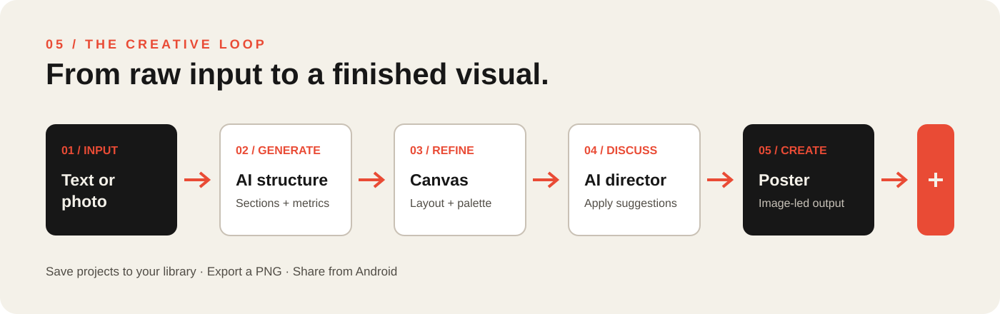

<div align="center">


<p><strong>Turn raw information into clear, editorial-grade visual stories.</strong><br />An AI-assisted infographic and poster studio for the web.</p>

<p>


</p>

<a href="#-the-idea">The idea</a> · <a href="#-the-studio">Studio</a> · <a href="#-capabilities">Capabilities</a> · <a href="#-architecture">Architecture</a> · <a href="#-getting-started">Get started</a>

</div>

---

## 00 / The idea

**InfoCraft** turns dense information into visual communication.

Start with pasted notes, article excerpts, metrics, a public webpage, a selectable-text PDF, or an image. InfoCraft uses AI to structure the material into an editorial Swiss-grid infographic, then gives you a canvas to refine its hierarchy, content, and visual direction. A separate poster workflow helps turn a creative brief into an image-led composition.

> Make information easier to understand — without making the design feel ordinary.

InfoCraft Web is the browser-based implementation of the InfoCraft product family. It is maintained separately from the original Android app in [NSKWeb/infocraft-](https://github.com/NSKWeb/infocraft-). The product identity, editorial direction, workflows, templates and palettes are carried forward, while the interface and technical implementation are adapted for the web.

## 00A / How InfoCraft works

<div align="center">
  
</div>

**In one glance:** input → AI organization → creative refinement → finished visual.

- **Bring input:** start with text, URLs, selectable-text PDFs, images, reports, notes, or metrics.
- **AI structures it:** organize information into a headline, key points, metrics, sections, and takeaways.
- **Refine the canvas:** choose a layout and palette, edit sections, and adjust the visual hierarchy.
- **Finish your work:** export the infographic, create a poster, prepare Pinterest metadata, or save the project in your Library.

The **AI Art Director** can assist during refinement. Search grounding is an optional context layer for supported workflows.

## 01 / The studio

### A focused creative workflow

| Workspace | What it does |
|---|---|
| **Create** | Start an infographic from text, URLs, PDFs, or images, with AI-assisted structuring. |
| **Canvas** | Refine the generated infographic, switch layouts and palettes, edit content, add/remove/reorder sections, and export. |
| **Poster Studio** | Prepare AI poster requests from the active project, with resolution and aspect-ratio controls. |
| **AI Art Director** | Ask for editorial improvements and apply supported suggestions back to the canvas. |
| **Pinterest SEO Studio** | Prepare pin titles, descriptions, hashtags, and image alt text for discovery workflows. |
| **Library** | Browse saved projects and continue working with their associated content and chat history. |

## 02 / Capabilities

<div align="center">
  
</div>

### From unstructured input to structured visual content

- **Text-to-infographic** — convert notes, reports, metrics, and article excerpts into a structured visual summary.
- **URL-to-infographic** — import readable text from supported public webpages.
- **PDF-to-infographic** — extract selectable text from PDF documents and use it as source material.
- **Photo-to-infographic** — use JPG, PNG, and WebP image input in supported vision workflows.
- **AI-assisted structure** — generate a title, subtitle, key metric, takeaway, and scannable content sections.
- **Search grounding** — optionally enrich supported workflows with Google Search context and available source citations.
- **Editorial refinement** — use the AI Art Director to improve copy, hierarchy, and layout direction.
- **Pinterest SEO** — generate pin-focused titles, descriptions, hashtags, and alt text.
- **Canvas export** — export PNG, JPEG, or WebP images, including scaled canvas sizes.
- **Project library** — persist and revisit infographic projects and their related chat messages through Firebase.

### Four Swiss-grid templates

| Template | Best suited to |
|---|---|
| **KPI_STACK** | Key numbers, performance indicators, and metric-led summaries |
| **PROCESS_FLOW** | Ordered stages, workflows, and sequential explanations |
| **COMPARISON** | Side-by-side differences and competing options |
| **DIGEST** | Compact editorial summaries and mixed information |

### Four visual palettes

- **Swiss Vermilion** — warm paper with a sharp editorial accent.
- **Cobalt Blueprint** — cool, technical, and analytical.
- **Charcoal Press** — high-contrast, publication-inspired.
- **Forest Ochre** — restrained natural tones.

### Poster and export controls

The poster interface exposes **1K, 2K, and 4K** resolution choices and aspect-ratio selection. Canvas export supports **PNG, JPEG, and WebP**, with scaled output options and portrait/Pinterest-oriented sizing. Actual poster output availability and native resolution depend on the configured image-generation model and provider limits.

## 03 / Product workflow

<div align="center">
  
</div>

1. **Start** with text, a public URL, a selectable-text PDF, or an image.
2. **Generate** a structured infographic using the configured AI workflow and optional search grounding.
3. **Refine** its template, palette, headline, sections, and visual hierarchy on the canvas.
4. **Discuss** improvements with the AI Art Director and apply supported revisions.
5. **Prepare** Pinterest metadata or create a poster when the project is ready for an image-led treatment.
6. **Save or export** your work and revisit saved projects in the Library.

The diagram describes the intended product journey. Individual integrations require the setup and verification described below.

## 04 / Architecture

InfoCraft Web uses a Next.js application with a browser-based React studio, server-side API routes, schema validation, Firebase services, and external AI services.

### Technology

| Layer | Technology |
|---|---|
| Platform | Web |
| Framework | Next.js 15 App Router |
| UI | React 19 |
| Language | TypeScript 5 |
| Styling | Tailwind CSS 4 tooling and component-level CSS |
| State and validation | React state, shared TypeScript types, Zod |
| AI integration | Google Gemini through server-side API routes |
| Authentication | Firebase Authentication, Google sign-in |
| Project and chat data | Cloud Firestore |
| Local draft storage | Browser localStorage |
| Icons | Lucide React |
| Build and runtime | Node.js 20.9+ |
| CI | GitHub Actions |
| Hosting target | Antideploy Node.js service |

### Source map

~~~text
infocraft-web-/
├── public/
│   └── infocraft/              # Original InfoCraft visual assets
├── src/
│   ├── app/
│   │   ├── api/                # AI, import, poster and health API routes
│   │   ├── globals.css
│   │   ├── layout.tsx
│   │   └── page.tsx
│   ├── components/             # Studio, editor and UI components
│   └── lib/                    # Firebase, schemas and shared utilities
├── docs/
│   └── ANTIDEPLOY.md
├── firestore.rules
├── .env.example
├── package.json
└── README.md
~~~

The repository tree is the source of truth for exact file names; this is a high-level map of the main application areas.

### Web implementation notes

- The **browser** owns the interactive studio, editor state, canvas rendering, client-side exports, and local draft fallback.
- **Next.js API routes** handle server-side AI requests and supported import processing.
- **Zod** validates request and generated data at application boundaries.
- **Firebase Authentication** provides Google sign-in; **Firestore** stores user-owned projects and project-scoped chat data.
- **Gemini** powers configured infographic and creative-assistance workflows.
- **Google Search grounding** is optional and only available for supported model/API combinations.

## 05 / Getting started

### Requirements

- Node.js **20.9 or newer** (Node.js 20 LTS recommended).
- npm.
- Git.
- Firebase and Gemini configuration for the integrations you want to use.

### 1. Clone the web repository

~~~bash
git clone https://github.com/NSKWeb/infocraft-web-.git
cd infocraft-web-
~~~

### 2. Install dependencies

~~~bash
npm install
~~~

When a committed lockfile is available, use `npm ci` for reproducible installs.

### 3. Configure environment

~~~bash
cp .env.example .env.local
~~~

Add the credentials for the integrations you want to run. Keep `.env.local` private and never commit it.

### 4. Start the development server

~~~bash
npm run dev
~~~

Open [http://localhost:3000](http://localhost:3000).

### 5. Run validation

~~~bash
npm run typecheck
npm run lint
npm run build
~~~

Run the production server locally with:

~~~bash
npm run start
~~~

> A successful local build does not by itself confirm that Gemini generation, Firebase sign-in, Firestore access, Search grounding, URL import, or poster generation is correctly configured. Test each integration separately.

## 06 / Configuration and security notes

- **Gemini:** set `GEMINI_API_KEY` as a server-side environment secret. Never expose it through a `NEXT_PUBLIC_*` variable.
- **Firebase Authentication:** enable the Google provider and configure authorized domains for local and deployed environments.
- **Firestore:** review and deploy the repository's `firestore.rules`; verify owner-scoped access with separate test accounts.
- **Source imports:** treat webpage text, PDF content, image input, and generated output as untrusted material.
- **Search grounding:** verify that the selected model and API configuration support the feature before enabling it.
- **App Check:** Firebase App Check is not integrated in this web implementation.
- **Provider limits:** confirm model availability, quotas, pricing, and regional support before production usage.
- **Publishing:** review generated facts, numerical claims, and citations against their original sources before sharing.

## 07 / Feature status and known limitations

InfoCraft Web is an evolving browser-based implementation. This table describes code paths present in the repository; it does not claim that external services or production deployments have been independently verified.

| Area | Repository evidence / current status |
|---|---|
| Web studio and navigation | Present |
| Editable canvas | Undo/redo, editable sections, add/remove/reorder, layout and palette controls |
| AI infographic generation | Gemini-backed server workflow; requires `GEMINI_API_KEY` and supported model access |
| AI Art Director | Gemini-backed contextual workflow; live provider test still required |
| Pinterest SEO Studio | Generation workflow implemented; requires Gemini configuration and output review |
| Canvas export | PNG, JPEG, WebP and scaled export options; cross-browser validation still needed |
| PDF export | Uses browser print dialog; not a server-generated PDF pipeline |
| Poster Studio | UI and image-generation API route present; provider output dimensions are not guaranteed |
| Firebase Authentication | Google sign-in integration present; provider/domain configuration required |
| Cloud Library | Firestore project sync and owner-scoped rules present; deploy and test rules |
| Chat persistence | Project-scoped Art Director message persistence present; verify multi-session behavior |
| URL import | Public HTTP(S) webpage text extraction present; production network controls and rate limiting needed |
| PDF import | Selectable-text extraction; scanned/image-only PDF OCR is not implemented |
| Photo understanding | Image input for vision analysis; live model/key test required |
| Search grounding | Optional workflow; verify supported model/API combination |
| Local drafts | Browser localStorage fallback; storage may be cleared or quota-limited |
| Firebase App Check | Not integrated |

### Important operational caveats

- **URL import hardening:** before exposing the importer to untrusted public traffic, add connection-level DNS pinning or equivalent egress controls and production rate limiting. URL/IP checks, redirect restrictions, timeouts, and response-size limits alone are not a complete production SSRF defense.
- **Poster output dimensions:** selecting 1K/2K/4K does not guarantee that the provider returns an image at those exact native pixel dimensions.
- **Scanned PDFs:** OCR for image-only or scanned PDFs is not included.
- **Browser validation:** code paths existing in the repository do not prove that all browser workflows, provider integrations, Firestore rules, and deployment settings have passed live tests.
- **Local drafts:** browser storage may be cleared, restricted, or quota-limited.

## 08 / Deployment

InfoCraft Web supports three deployment paths:

- **Vercel** — recommended for the simplest Next.js deployment; framework detection and Next.js runtime support are built in.
- **Netlify** — supported through Netlify's Next.js adapter; the repository includes a minimal `netlify.toml`.
- **Antideploy** — run as a standard Node.js service using the production start script.
- **Any VPS** — deploy on a Linux VPS (Ubuntu/Debian or another Node.js 20-compatible distribution) using Node.js, systemd/PM2, Nginx, and HTTPS.

### Shared build settings

| Setting | Value |
|---|---|
| Node.js | 20.x (20.9+ recommended) |
| Install | `npm install` (no lockfile is currently committed) |
| Build | `npm run build` |
| Start | `npm run start` (Node.js server hosting) |
| Health check | `/api/health` |

Do not configure a static output directory or static export: the app uses server/API routes.

### Vercel

Import `NSKWeb/infocraft-web-`, keep the root directory as `./`, choose the **Next.js** framework preset (normally auto-detected), and leave the output directory at its default. Set the required environment variables in Project Settings → Environment Variables.

### Netlify

Import `NSKWeb/infocraft-web-` from the repository root. Use `npm run build` and leave the publish directory blank so Netlify's Next.js adapter manages the runtime output. The repository's `netlify.toml` pins Node.js 20.x and the build command. Add environment variables in Site configuration → Environment variables.

### Antideploy

Use Node.js 20, `npm install`, `npm run build`, and `npm run start`. Configure the platform-provided `PORT` and health-check path `/api/health`.

### Universal VPS deployment

For a self-managed Linux VPS, use the standard Node.js production server behind Nginx. This works on common Ubuntu/Debian VPS providers and does not depend on a provider-specific deployment platform.

1. Install Node.js 20.x (20.9+), Git, and Nginx using your distribution's supported package/source instructions.
2. Clone the repository to a persistent directory such as `/var/www/infocraft-web`.
3. Create a private production environment file (for example `/etc/infocraft-web.env`) with the Firebase variables and server-only `GEMINI_API_KEY` described above. Restrict file permissions; do not commit it.
4. Run `npm install`, `npm run build`, then start with `npm run start` using `PORT=3000`.
5. Keep the app running with systemd or PM2, and configure Nginx as a reverse proxy to `127.0.0.1:3000`.
6. Point your domain's DNS A/AAAA records to the VPS and enable HTTPS with Certbot/Let's Encrypt or your preferred certificate manager.
7. Allow inbound SSH and web traffic (80/443) in the VPS firewall; keep the Node.js app port private.

Example production commands:

```bash
git clone https://github.com/NSKWeb/infocraft-web-.git /var/www/infocraft-web
cd /var/www/infocraft-web
npm install
npm run build
PORT=3000 npm run start
```

For a persistent service, create a systemd unit that runs `npm run start` from the project directory, loads the protected environment file with `EnvironmentFile=/etc/infocraft-web.env`, sets `Environment=NODE_ENV=production` and `Environment=PORT=3000`, and uses `Restart=always`. Run it as a dedicated non-root application user. Configure Nginx to proxy requests to `http://127.0.0.1:3000` and preserve the original Host and forwarded protocol headers.

After deployment, verify `https://YOUR_DOMAIN/api/health` and test sign-in, Firestore, Gemini, imports, and exports. For updates, pull the intended commit, install dependencies, rebuild, then restart the service. Back up required data/configuration before upgrades.

### Required environment variables

Set Firebase values `NEXT_PUBLIC_FIREBASE_API_KEY`, `NEXT_PUBLIC_FIREBASE_AUTH_DOMAIN`, `NEXT_PUBLIC_FIREBASE_PROJECT_ID`, and `NEXT_PUBLIC_FIREBASE_APP_ID`. Optional values are `NEXT_PUBLIC_FIREBASE_STORAGE_BUCKET` and `NEXT_PUBLIC_FIREBASE_MESSAGING_SENDER_ID`. Set `GEMINI_API_KEY` as a server-only secret; never use a `NEXT_PUBLIC_` prefix for it.

For each deployed hostname, configure Firebase Authentication's authorized domains and enable the Google provider. Deploy and review `firestore.rules` before using cloud saves.

See [docs/ANTIDEPLOY.md](docs/ANTIDEPLOY.md) for full setup and verification steps for all three providers.

A successful build or health response is not a substitute for end-to-end testing of sign-in, Firestore, AI generation, imports, and exports.

## 09 / Contributing

This repository is currently maintained separately from the original Android project. If you have access and want to contribute:

1. Create a focused branch from `main`.
2. Keep changes scoped and describe the user-visible impact.
3. Document new environment variables and setup requirements.
4. Run typecheck, lint, and build before opening a pull request.
5. Test affected workflows in a browser and state which integrations were not tested.
6. Include screenshots or short recordings for interface changes.
7. Never include credentials, tokens, signing keys, or private user data.

## 10 / Related project

- **Web implementation:** [NSKWeb/infocraft-web-](https://github.com/NSKWeb/infocraft-web-)
- **Original Android project:** [NSKWeb/infocraft-](https://github.com/NSKWeb/infocraft-)

The projects share the InfoCraft product identity, visual language, core workflows, templates, and palettes. They use different platform implementations and are maintained independently; changes do not automatically sync between repositories.

## 11 / License

InfoCraft Web is licensed under the **MIT License**. See the [`LICENSE`](LICENSE) file for the complete license text.

The license applies to code and materials owned by the project copyright holder. Third-party libraries, services, trademarks, and assets remain subject to their respective licenses and terms.

---

<div align="center">
  <sub>InfoCraft — clarity, composed.</sub>
  <sub>Built around clarity. Designed with intention. Powered by AI.</sub>
</div>
