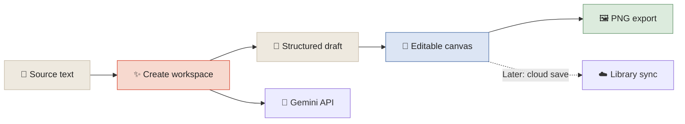
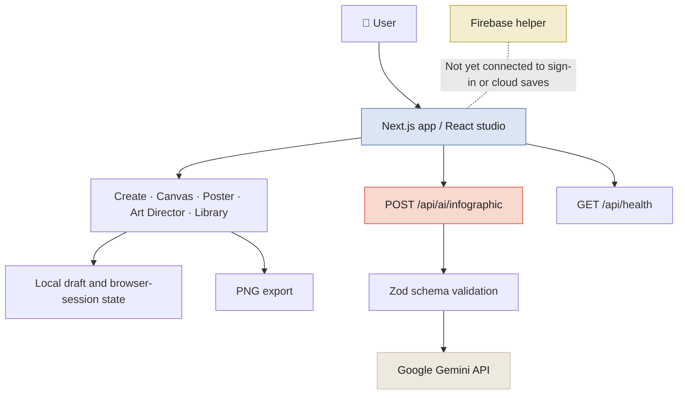
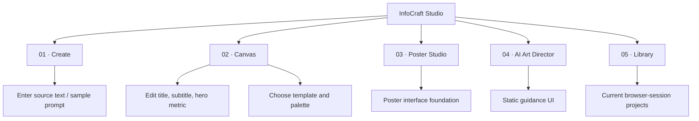
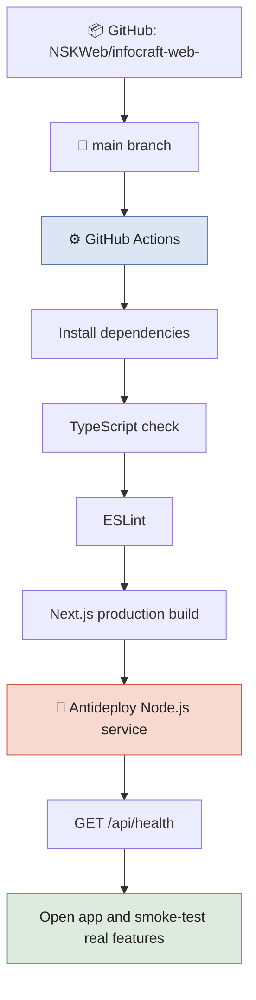
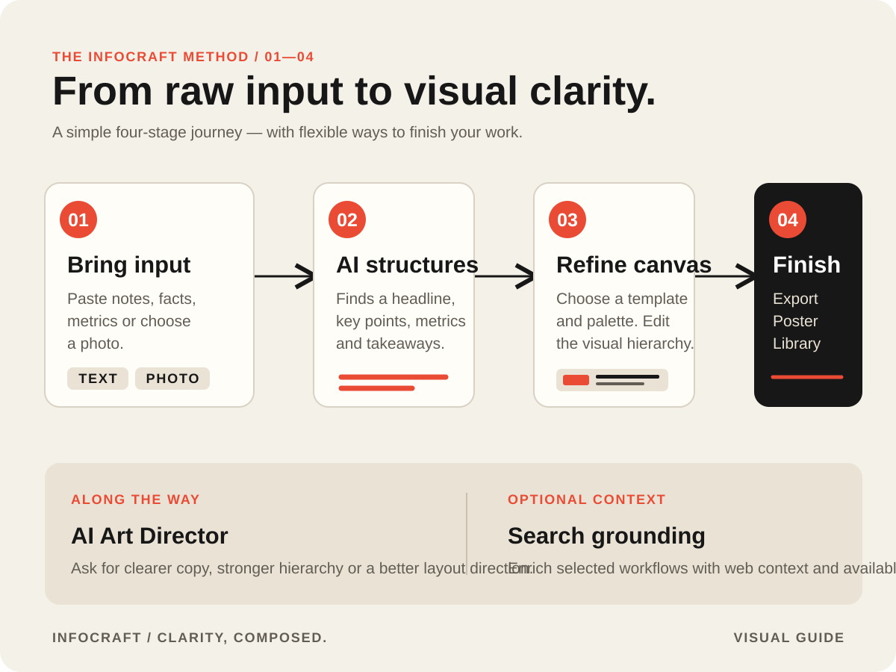

# InfoCraft Web

<p align="center">
  <strong>Turn information into visual stories.</strong><br/>
  A web-based editorial infographic studio, designed around clarity, structure, and a Swiss-inspired visual system.
</p>

<p align="center">
  
  
  
  
  
</p>

**InfoCraft Web** is a separate web implementation inspired by the InfoCraft product. It lives in its own repository and does not replace or modify the original `NSKWeb/infocraft-` project.

> **Project status:** Feature-parity migration in progress. Original InfoCraft visual assets are now included, the Create screen calls the Gemini API route, and the studio includes the editable canvas, local session library, PNG export path and health endpoint. Authentication, cloud persistence, photo understanding, live Art Director, poster generation and search grounding remain to be migrated. See [Feature status](#feature-status) before treating this as production-ready.

---

## Contents

- [Product vision](#product-vision)
- [Interface overview](#interface-overview)
- [Feature status](#feature-status)
- [Technology stack](#technology-stack)
- [Repository structure](#repository-structure)
- [Run locally](#run-locally)
- [Environment configuration](#environment-configuration)
- [AI generation API](#ai-generation-api)
- [Antideploy deployment](#antideploy-deployment)
- [GitHub Actions](#github-actions)
- [Security and privacy](#security-and-privacy)
- [Troubleshooting](#troubleshooting)
- [Development roadmap](#development-roadmap)
- [Contributing](#contributing)

---

## Product vision

InfoCraft is being shaped as a focused workspace for turning dense information into clear, polished infographic compositions.

The design direction is:

- **Editorial, not cluttered:** strong typography, intentional whitespace and clear information hierarchy.
- **Image-first output:** portrait-oriented visual compositions suited to sharing and publishing.
- **Dark by default:** a dark studio interface with a warm editorial canvas; a light interface option is included.
- **Responsive:** the workspace adapts to desktop and mobile screen sizes.
- **Reviewable:** generated content should remain editable, and factual claims should be checked against their source before publication.

The long-term product direction includes text-to-infographic creation, photo understanding, assisted editing, poster generation, project management and optional research grounding. Not every planned capability is available yet.

## InfoCraft at a glance — visual guide

> New to the project? Start with these visual maps. They explain what the app is, how its current pieces connect, and what a deployment actually checks.

### 1. The product in one picture



**In plain language:** provide information → create a draft → refine the layout → export the visual. Cloud save remains a future integration; Gemini generation is now connected from Create when the server key is configured.

### 2. How the current app is organized



**What this means:** the browser renders the studio; the Next.js server exposes API routes; the AI route validates structured output. Firebase is currently only an initialization helper. The Create screen now calls the Gemini route when GEMINI_API_KEY is configured. Firebase is still only an initialization helper.

### 3. The five workspace areas



| Workspace | Think of it as… | Current state |
|---|---|---|
| Create | The starting desk | Text input + local draft creation |
| Canvas | The design table | Editable content and visual choices |
| Poster Studio | The poster workbench | Interface foundation |
| AI Art Director | A creative assistant | Static guidance, not live AI chat |
| Library | Your project shelf | Session-only; not cloud synced |

### 4. From GitHub to Antideploy



**Important:** a green CI/build and a healthy `/api/health` response are not the same as a fully tested product. Sign-in, AI, uploads, persistence and other external services must be tested separately when implemented.

### 5. What works now vs. what comes next

| <span>🟢</span> Available foundation | <span>🟡</span> Needs integration / completion |
|---|---|
| Responsive studio shell | Firebase sign-in |
| Dark-first UI and light appearance | Firestore cloud Library |
| Local structured draft | Create screen → Gemini API |
| Editable canvas controls | Photo understanding |
| Template and palette selectors | Live AI Art Director |
| Browser-session Library | AI poster/image generation |
| PNG export action | Web research grounding and citations |
| Health route + deployment guide | Full production smoke tests |

### 6. A simple mental model

<blockquote>
  **Frontend = what people see.**  
  **API routes = the server-side doorway.**  
  **AI provider = the content engine.**  
  **Firebase = the planned identity and cloud-data layer.**  
  **Antideploy = where the web app runs.**
</blockquote>

If you are contributing code, use the [repository structure](#repository-structure), then follow [Run locally](#run-locally). If you are deploying, jump to [Antideploy deployment](#antideploy-deployment).

---

## Interface overview

The current workspace is organized into five destinations:

| Area | Purpose | Current behavior |
|---|---|---|
| **Create** | Start with source text or a selected image | Text input, sample prompts and a local structured-draft fallback. Image selection is currently a UI placeholder. |
| **Canvas** | Refine the infographic | Edit headline, subtitle and hero metric; select a layout and color palette; preview the composition. |
| **Poster Studio** | Prepare poster output | Interface foundation; full image-generation workflow is not connected. |
| **AI Art Director** | Get help shaping the story | Conversation UI with static guidance; live AI conversation is not connected. |
| **Library** | Revisit saved work | In-memory browser-session list; not persistent cloud storage. |

### Visual system

**Layouts**
- KPI Stack
- Process Flow
- Comparison
- Editorial Digest

**Color palettes**
- Swiss Vermilion
- Cobalt Blueprint
- Charcoal Press
- Forest Ochre

**Canvas format**
- Portrait preview: 1080 × 1350
- Editable title, subtitle and hero metric
- Section-based editorial hierarchy
- PNG export action

The current preview is a front-end composition. Do not assume every layout selection changes the underlying information structure in a specialized way yet.

## Feature status

The original Android app is the product source of truth. This web repository is a separate implementation, not a different product. The migration target is the complete original capability set, adapted to browser workflows.

| Original InfoCraft capability | Web status | Migration target |
|---|---|---|
| Text-to-infographic | Connected, needs live-key verification | Preserve source text, structured sections, hero metric and selected template |
| Generation modes: Instant Draft / Deep Synthesis | Partial | Add explicit FAST and HIGH_THINKING model selection |
| Photo Scan / photo-to-infographic | Not implemented | Upload image securely and send vision input to the server-side model |
| Google Search grounding | Not implemented | Add opt-in grounding, source URLs and citation display |
| Four Swiss-grid templates | Partial | KPI Stack, Process Flow, Comparison and Editorial Digest renderers |
| Four visual palettes | Implemented as choices | Match original palette tokens in every renderer and export |
| Editable infographic canvas | Partial | Edit all project fields and section data, not only headline/subtitle/hero metric |
| AI Art Director | UI present; static replies | Live contextual chat, streamed response and structured apply-to-canvas patches |
| Poster generation | Controls only | Real image generation with 1K/2K/4K and 3:4, 9:16, 1:1, 16:9 ratios |
| Project Library | Browser session only | Firestore-backed projects, live updates, reopen, delete and cross-device sync |
| Chat history per project | Not implemented | Persist messages under each infographic |
| Google authentication | Not implemented | Firebase Auth / Google sign-in |
| PNG export and share | PNG path present | Validate export fidelity, responsive rendering and browser download/share |
| App Check / secure data access | Not implemented | Web-compatible App Check strategy and owner-only Firestore rules |
| Original visual identity and diagrams | Added | Reuse original SVG artwork and retain editorial Swiss-grid style |

**Important:** the original Android repository documents these capabilities in its README and implements the native workflows in Kotlin/Jetpack Compose. Web status above is based on the current web source code, not assumed from the Android implementation. Do not treat planned or partial rows as shipped.

### Original InfoCraft visual language

The following artwork is carried over from the original repository into `public/infocraft/` and reused in the web studio:

<p align="center"></p>
<p align="center"></p>
<p align="center"></p>
## Technology stack

| Layer | Technology |
|---|---|
| Web framework | Next.js 15 App Router |
| UI | React 19 |
| Language | TypeScript 5 |
| Styling | Tailwind CSS 4 tooling + component-level CSS |
| Icons | Lucide React |
| Validation | Zod |
| AI provider package | Google Generative AI SDK |
| Client backend foundation | Firebase Web SDK |
| Hosting target | Antideploy / Node.js runtime |
| CI | GitHub Actions |

## Repository structure

```text
infocraft-web/
├── .github/
│   └── workflows/
│       └── ci.yml                 # Typecheck, lint and build workflow
├── docs/
│   └── ANTIDEPLOY.md              # Hosting and environment notes
├── src/
│   ├── app/
│   │   ├── api/
│   │   │   ├── ai/
│   │   │   │   └── infographic/
│   │   │   │       └── route.ts   # Server-side infographic API
│   │   │   └── health/
│   │   │       └── route.ts       # Health endpoint
│   │   ├── globals.css
│   │   ├── layout.tsx
│   │   └── page.tsx
│   ├── components/
│   │   ├── studio.tsx             # Main client-side studio
│   │   └── studio.css             # Responsive studio design
│   └── lib/
│       ├── firebase.ts            # Safe Firebase initialization helper
│       ├── infographic-schema.ts  # Zod response validation
│       └── types.ts               # Shared project and design types
├── .env.example
├── .gitignore
├── eslint.config.mjs
├── next.config.ts
├── package.json
├── postcss.config.mjs
├── tsconfig.json
└── README.md
```

## Run locally

### Requirements

- Node.js 20.9 or newer (Node 20 LTS recommended)
- npm
- Git

### 1. Clone the repository

```bash
git clone https://github.com/NSKWeb/infocraft-web-.git
cd infocraft-web-
```

### 2. Install dependencies

```bash
npm install
```

The repository currently does not include a committed npm lockfile. Use `npm install` to resolve dependencies and generate `package-lock.json`. For repeatable CI and deployments, commit the generated lockfile and then prefer `npm ci`.

### 3. Configure environment

```bash
cp .env.example .env.local
```

Add the values required for the integrations you intend to test. The local UI fallback can be explored without Firebase credentials.

### 4. Start the development server

```bash
npm run dev
```

Open [http://localhost:3000](http://localhost:3000).

### 5. Validate before pushing

```bash
npm run typecheck
npm run lint
npm run build
```

Start the production build locally:

```bash
npm run start
```

---

## Environment configuration

Copy `.env.example` to `.env.local`. Never commit `.env.local`.

| Variable | Required for | Exposure | Description |
|---|---|---|---|
| `NEXT_PUBLIC_FIREBASE_API_KEY` | Firebase web app | Browser-visible | Firebase web app API key |
| `NEXT_PUBLIC_FIREBASE_AUTH_DOMAIN` | Firebase web app | Browser-visible | Firebase Auth domain |
| `NEXT_PUBLIC_FIREBASE_PROJECT_ID` | Firebase web app | Browser-visible | Firebase project identifier |
| `NEXT_PUBLIC_FIREBASE_APP_ID` | Firebase web app | Browser-visible | Firebase app identifier |
| `NEXT_PUBLIC_FIREBASE_STORAGE_BUCKET` | Optional Firebase Storage | Browser-visible | Storage bucket name |
| `NEXT_PUBLIC_FIREBASE_MESSAGING_SENDER_ID` | Optional Firebase Messaging | Browser-visible | Sender identifier |
| `GEMINI_API_KEY` | Server-side Gemini route | **Server secret** | Google AI provider key; never prefix with `NEXT_PUBLIC_` |
| `PORT` | Hosting runtime | Server runtime | Port supplied by Antideploy; defaults to 3000 in the start command |

Firebase web configuration is designed to be used by browser applications; it is not a substitute for Firebase Authentication, Firestore Security Rules or App Check. Protect user data with correct server-side and database authorization.

### Firebase setup (when integration is implemented)

1. Create or select a Firebase project.
2. Register a Web App in Project settings.
3. Copy its web configuration into the matching environment variables.
4. Configure the Authentication providers you intend to support.
5. Add the deployed hostname to Firebase Authentication's authorized domains.
6. Design and deploy Firestore rules before storing user projects.

Firebase initialization currently exists as a helper only; the current UI does not yet provide sign-in or Firestore-backed saving.

---

## AI generation API

A server-side route is present at:

`POST /api/ai/infographic`

It is intended to accept a JSON request containing:

```json
{
  "sourceText": "Source material to turn into an infographic",
  "model": "gemini-2.5-flash",
  "template": "DIGEST"
}
```

Supported model identifiers in the route:
- `gemini-2.5-flash`
- `gemini-2.5-pro`

Supported template identifiers:
- `KPI_STACK`
- `PROCESS_FLOW`
- `COMPARISON`
- `DIGEST`

The route checks source length, restricts the model selection, requests JSON output and validates the response with the Zod schema in `src/lib/infographic-schema.ts`.

**Integration caveat:** the current Create screen still uses its deterministic local draft path; it does not call this API route. Treat the API as an integration foundation until it is wired to the UI and tested with a valid provider key, model availability, error handling and real sample inputs. The route's error detail is intended for diagnostics; review logging and error disclosure before production.

### Example request

```bash
curl -X POST http://localhost:3000/api/ai/infographic \
  -H "Content-Type: application/json" \
  -d '{
    "sourceText": "A sufficiently detailed source text describing a topic, its evidence and key findings.",
    "model": "gemini-2.5-flash",
    "template": "DIGEST"
  }'
```

### Health check

`GET /api/health`

Example response:

```json
{
  "status": "ok",
  "service": "infocraft-web"
}
```

This endpoint confirms that the Next.js process can respond. It does not test Firebase, Gemini, database connectivity or other external services.

---

## Antideploy deployment

The project is intended to run as a standard Node.js Next.js application.

| Setting | Value |
|---|---|
| Runtime | Node.js 20 |
| Install command | `npm install` (use `npm ci` after committing a lockfile) |
| Build command | `npm run build` |
| Start command | `npm run start` |
| Health-check path | `/api/health` |
| Port | Use the platform-provided `PORT` |

The start script binds Next.js to `0.0.0.0` and uses the injected `PORT` value, falling back to 3000 for local execution.

### Deployment checklist

1. Connect the **`NSKWeb/infocraft-web-`** repository, not the original Android/source repository.
2. Select the `main` branch.
3. Select the Node.js runtime and the commands above.
4. Add only the environment variables needed by the features being tested.
5. Do not set `FIRESTORE_EMULATOR_HOST` in production.
6. Deploy and inspect the build output.
7. Open `/api/health` on the deployed hostname.
8. Test the actual UI and any configured external integrations separately.

Detailed notes: [docs/ANTIDEPLOY.md](docs/ANTIDEPLOY.md).

> Antideploy compatibility is a deployment target, not a guarantee of error-free hosting. A successful deployment must still be verified in the target environment.

---

## GitHub Actions

The workflow at `.github/workflows/ci.yml` runs on pushes to `main`, `staging` and `feature/**`, pull requests targeting `main`, and manual dispatch.

Current validation steps:

1. Checkout source
2. Set up Node.js 20
3. Install npm dependencies
4. Run TypeScript type checking
5. Run ESLint
6. Build the Next.js application

View workflow runs in the repository's **Actions** tab.

---

## Security and privacy

- Keep API keys, tokens and private credentials out of source code and commit history.
- Never expose provider secrets through `NEXT_PUBLIC_*` variables.
- Do not add Firebase Admin credentials or service-account JSON to the browser bundle.
- Configure Firebase Authentication and owner-scoped Firestore rules before introducing user data.
- Validate and constrain all AI-generated structured content before rendering or saving.
- Treat source documents and AI output as untrusted input.
- Apply upload type and size limits before enabling image processing.
- Avoid returning raw provider errors or sensitive diagnostics to end users.
- Do not enable a production Firestore emulator endpoint.
- Review dependency updates and GitHub Actions permissions periodically.

Report security issues privately to the repository maintainers rather than posting secrets or exploit details in public issues.

## Troubleshooting

### Build fails during dependency installation

- Confirm Node.js is version 20.9 or newer.
- Run `npm install` to resolve dependencies.
- If a lockfile has been committed, use `npm ci`.
- Inspect the first actual npm error rather than only the final failure line.

### Application starts but the health check fails

- Confirm the start command is `npm run start`.
- Ensure the service binds to `0.0.0.0`.
- Confirm the platform-provided `PORT` is honored.
- Inspect runtime logs for the first application error.

### AI generation reports that it is not configured

- Set `GEMINI_API_KEY` as a server-side environment secret.
- Redeploy after changing environment variables.
- Verify that the selected model is available to the key/project.
- Remember that the current Create screen uses a local fallback and is not yet connected to the AI route.

### Firebase is not connected

- Check the `NEXT_PUBLIC_FIREBASE_*` values and deployed hostname.
- Confirm Firebase Authentication authorized domains.
- Remember that Firebase auth and cloud project persistence are not yet implemented in the current UI.

### Changes do not appear after deployment

- Confirm the deployment used the intended repository and `main` branch.
- Check the deployed commit SHA.
- Review the deployment build and runtime logs.
- Trigger a new deployment after configuration changes when required.

---

## Development roadmap

The next development stages are planned as follows:

- [ ] Complete and verify a reproducible production build
- [ ] Wire the Create screen to the server-side AI route
- [ ] Add robust AI output validation, retry handling and factual review cues
- [ ] Implement Firebase Authentication
- [ ] Add owner-scoped Firestore project storage and cross-device Library
- [ ] Implement photo upload, image understanding and source extraction
- [ ] Connect the Art Director to a real conversational model
- [ ] Implement poster/image generation and output controls
- [ ] Add optional web research grounding and traceable citations
- [ ] Add export quality, accessibility and browser compatibility tests
- [ ] Complete security review and Antideploy production smoke tests

Roadmap items are goals, not claims that those features are already available.

## Contributing

1. Create a feature branch from `main`.
2. Keep changes focused and document any new environment variables.
3. Run typecheck, lint and build locally.
4. Never commit real secrets or user data.
5. Open a pull request with a clear summary, screenshots for UI changes and verification notes.

## Project separation

- **Web project:** [NSKWeb/infocraft-web-](https://github.com/NSKWeb/infocraft-web-)
- **Original project:** [NSKWeb/infocraft-](https://github.com/NSKWeb/infocraft-)

The web implementation is developed independently. Changes to this repository do not automatically change the original project.

---

<p align="center">
  <strong>InfoCraft</strong><br/>
  <sub>Clarity, composed.</sub>
</p>


## Six-phase implementation update

The web implementation now includes the following integration paths. External credentials and provider/model availability are still required for live service behavior; do not interpret code presence as a successful production integration test.

| Phase | Implemented in repository |
|---|---|
| 1 — Advanced editor | Editable section content, add/remove/reorder, undo/redo, templates, palettes and PNG export |
| 2 — AI Art Director | Context-aware server endpoint using Gemini; conversation responses are generated live when `GEMINI_API_KEY` is configured |
| 3 — Pinterest / social studio | AI-assisted Pinterest pin title, description, hashtag and alt-text generation |
| 4 — Advanced output | PNG, JPEG, WebP, scaled 1K/2K/4K canvas exports, Pinterest 2:3 sizing, print-to-PDF workflow, plus an AI poster endpoint |
| 5 — Cloud workspace | Google sign-in, Firestore project sync, cloud Library subscription and owner-scoped Firestore rules |
| 6 — Source intelligence | Photo input for infographic vision analysis, webpage text import, optional Google Search grounding/citations, and English/Hindi/Hinglish/Odia output selection |

### Required setup for live integrations

1. Set the Firebase Web App values in the deployment environment.
2. Enable Google as a Firebase Authentication provider and add the deployed hostname to Authorized domains.
3. Deploy `firestore.rules` to the same Firebase project before using cloud saves.
4. Set `GEMINI_API_KEY` as a server-only secret in the hosting provider.
5. Confirm that the Google AI project supports the requested text, search-grounding and image-generation models. Model availability and output resolution are controlled by the provider; the UI's requested poster resolution is not a guarantee of native model output dimensions.
6. Run the CI workflow and complete browser-level tests with real Firebase and Gemini credentials before production use.

The URL importer accepts public HTTP(S) HTML/plain-text pages only. It is not a general-purpose crawler and does not bypass paywalls or authentication. Review imported and AI-generated content, especially citations and numeric claims, before publishing.
