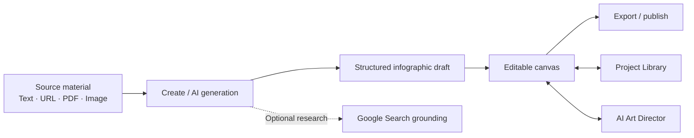
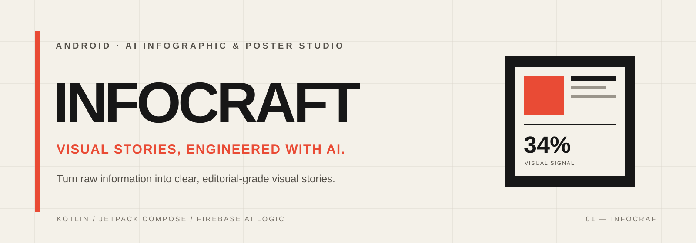
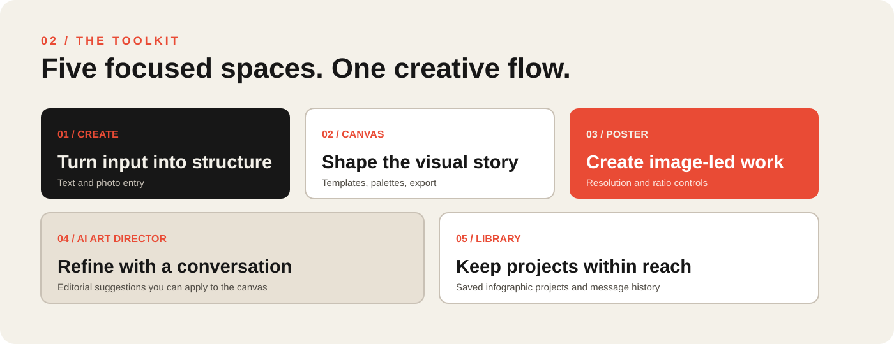
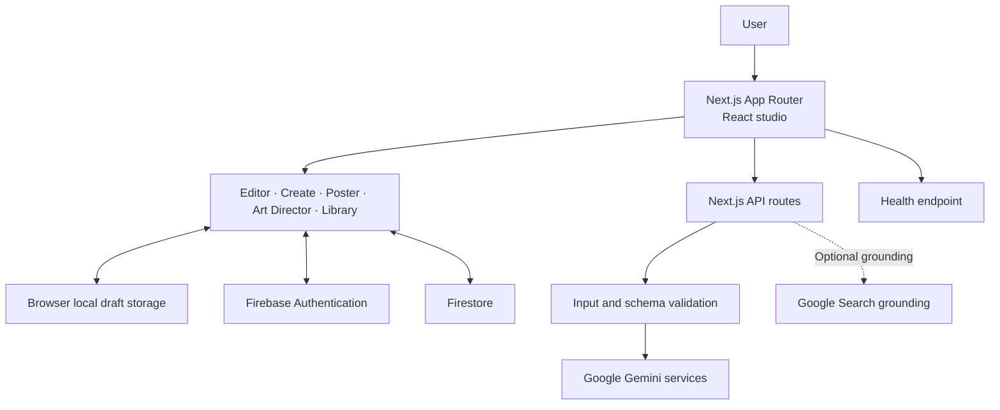
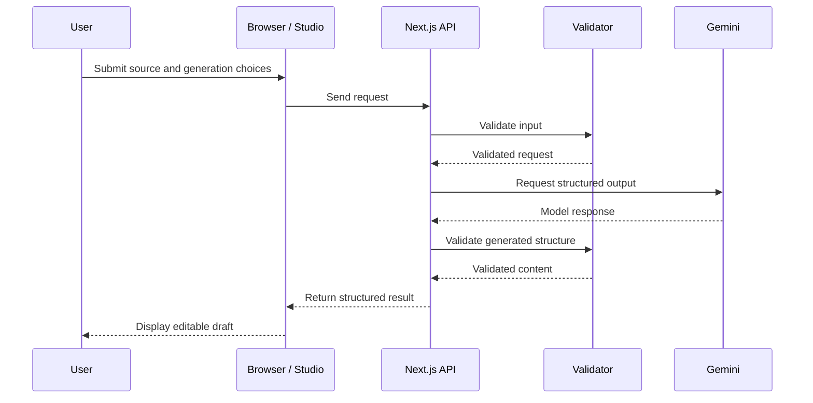

# InfoCraft Web

<p align="center">
  <strong>Turn information into visual stories.</strong><br/>
  An editorial infographic studio for transforming source material into structured, editable visual content.
</p>

<p align="center">
  
  
  
  
  
</p>

<p align="center">
  <a href="#overview">Overview</a> ·
  <a href="#features">Features</a> ·
  <a href="#architecture">Architecture</a> ·
  <a href="#getting-started">Getting started</a> ·
  <a href="#deployment">Deployment</a> ·
  <a href="#security">Security</a>
</p>

> **Project:** `NSKWeb/infocraft-web-`  
> **Status:** Active development. The web app has a working editor and several AI, export, import and Firebase integration paths. Live behavior depends on provider credentials, Firebase configuration and deployment setup. Read [Feature status](#feature-status) and [Known limitations](#known-limitations) before production use.

InfoCraft Web is an independent browser-based implementation inspired by the original InfoCraft project. It does not replace or automatically modify the original Android repository.

---

## Contents

- [Overview](#overview)
- [Product workflow](#product-workflow)
- [Features](#features)
- [Feature status](#feature-status)
- [Interface and design system](#interface-and-design-system)
- [Architecture](#architecture)
- [Technology stack](#technology-stack)
- [Repository structure](#repository-structure)
- [Getting started](#getting-started)
- [Environment variables](#environment-variables)
- [AI and application API](#ai-and-application-api)
- [Firebase setup](#firebase-setup)
- [Deployment](#deployment)
- [CI workflow](#ci-workflow)
- [Security](#security)
- [Known limitations](#known-limitations)
- [Troubleshooting](#troubleshooting)
- [Roadmap](#roadmap)
- [Contributing](#contributing)
- [Related project](#related-project)

---

## Overview

InfoCraft helps users turn dense source material into clear, polished infographic compositions. The product combines AI-assisted content creation with a visual editor, export tools and a project workspace.

### Product principles

- **Editorial clarity:** strong typography, structured sections and intentional whitespace.
- **Visual storytelling:** portrait-oriented compositions designed for sharing and publishing.
- **Editable by design:** generated content should be refinable rather than locked into a flat image.
- **Dark-first experience:** the studio defaults to a dark interface, with a light appearance option.
- **Responsive workspace:** layouts adapt to desktop and mobile screens.
- **Source-aware creation:** imported material and AI-generated claims should be reviewed before publication.

### Project boundaries

This repository contains the web implementation. It is developed separately from the original Android app; feature parity is a migration goal, not an assumption.

---

## Product workflow

The high-level creation journey is:



1. **Bring in source material.** Start with text or use a supported import path.
2. **Generate a draft.** The server-side AI workflow can create structured infographic content when configured.
3. **Refine the composition.** Edit content, arrange sections, and adjust visual choices in the canvas.
4. **Get creative assistance.** Use the Art Director and Pinterest SEO workflow where configured.
5. **Save and export.** Use the Library and available image/PDF export paths.

The workflow diagram describes the product experience. Individual integrations still require the setup and verification described below.

---

## Features

### 1. Infographic editor

- Editable infographic content and section data
- Add, remove and reorder sections
- Undo and redo
- Layout and palette selection
- Portrait-oriented canvas preview

### 2. AI-assisted creation

- Gemini-backed server routes for infographic and creative workflows
- Structured response validation
- Contextual AI Art Director workflow
- Pinterest-focused title, description, hashtag and alt-text assistance

### 3. Source intelligence

- Public webpage text import
- Selectable-text PDF extraction
- JPG, PNG and WebP image input for vision workflows
- Optional Google Search grounding and citation extraction
- Output language choices including English, Hindi, Hinglish and Odia

### 4. Poster and export studio

- Poster-generation API and UI workflow
- PNG, JPEG and WebP canvas exports
- Scaled canvas export options (1K / 2K / 4K)
- Standard portrait and Pinterest-oriented sizing
- Browser print-to-PDF workflow

### 5. Project workspace

- Google sign-in through Firebase Authentication
- Owner-scoped Firestore project storage
- Cloud Library subscription
- Project-scoped Art Director chat persistence
- Local browser-storage fallback for signed-out drafts

---

## Feature status

This is the consolidated status reference for the web implementation. It supersedes older diagrams, tables and early migration notes that may describe an earlier stage of the project.

| Capability | Current implementation | Setup / verification still needed |
|---|---|---|
| Advanced canvas editor | Undo/redo, editable sections, add/remove/reorder, layout and palette controls | Browser interaction and export-fidelity testing |
| AI infographic generation | Server-side Gemini generation workflow and structured validation | `GEMINI_API_KEY`, supported model access and live test |
| AI Art Director | Gemini-backed contextual chat workflow | Live provider test and end-to-end browser validation |
| Pinterest SEO Studio | Pin title, description, hashtags and alt-text generation | Gemini key and output review |
| Export | PNG, JPEG, WebP, scaled canvas export and print-to-PDF | Cross-browser validation; PDF uses browser print dialog |
| Poster Studio | Poster UI and image-generation API route | Provider model access and actual output dimensions |
| Firebase Authentication | Google sign-in integration | Enable Google provider and configure authorized domains |
| Cloud Library | Firestore project sync with owner-scoped rules | Deploy rules and test with real accounts |
| Chat persistence | Project-scoped Art Director message persistence | Verify rules and multi-session behavior |
| URL import | Public HTTP(S) webpage text extraction | Production network controls and rate limiting |
| PDF import | Selectable-text extraction | OCR for scanned/image-only PDFs is not implemented |
| Photo understanding | Image input for vision analysis | Live model/key test and upload validation |
| Search grounding | Optional Google Search grounding and citation extraction | Verify supported model/API combination |
| Local drafts | Browser localStorage fallback | Browser storage may be cleared or quota-limited |
| Firebase App Check | Not integrated | Plan and implement before broader public rollout |

**Status language:** “Implemented” means a code path exists in this repository. It does not mean that external credentials, provider access, deployed security rules, hosting or real-browser behavior have been independently verified.

---

## Interface and design system

The studio is organized around these work areas:

| Area | Purpose |
|---|---|
| **Create** | Start an infographic from source material |
| **Canvas** | Edit content and visual composition |
| **Poster Studio** | Prepare poster/image-generation requests |
| **AI Art Director** | Get contextual creative assistance |
| **Pinterest SEO Studio** | Prepare social discovery metadata |
| **Library** | Reopen saved projects |

### Visual direction

- Dark-first studio interface with a light appearance option
- Minimal, spacious editorial layout
- Swiss-inspired grid and information hierarchy
- Responsive controls and canvas preview
- Image-first output designed for social sharing

### Layouts and palettes

The editor includes layout choices such as KPI Stack, Process Flow, Comparison and Editorial Digest, alongside palettes such as Swiss Vermilion, Cobalt Blueprint, Charcoal Press and Forest Ochre.

The canvas preview is a browser composition. Validate each layout and export at the target viewport before relying on pixel-perfect output.

### Original visual assets

The repository carries visual assets from the original project in `public/infocraft/`:

<p align="center">
  
</p>
<p align="center">
  
</p>
<p align="center">
  
</p>

---

## Architecture

### System overview



### Main responsibilities

| Layer | Responsibility |
|---|---|
| Next.js / React client | Studio interface, editor interactions, project views and export interactions |
| Next.js API routes | Server-side AI requests, import processing and health response |
| Zod schemas | Validate structured data at application boundaries |
| Gemini | AI generation, creative assistance and supported vision workflows |
| Firebase Auth | User identity and Google sign-in |
| Firestore | User-owned projects and project-scoped chat data |
| Browser storage | Local draft fallback |
| GitHub Actions | Typecheck, lint and production build validation |
| Antideploy | Target Node.js hosting environment |

### Request lifecycle



The sequence shows the intended server-side generation boundary. Exact request fields and route behavior are defined by the current source code.

---

## Technology stack

| Layer | Technology |
|---|---|
| Framework | Next.js 15 App Router |
| UI | React 19 |
| Language | TypeScript 5 |
| Styling | Tailwind CSS 4 tooling and component-level CSS |
| Icons | Lucide React |
| Schema validation | Zod |
| AI provider | Google Generative AI SDK / Gemini |
| Authentication and data | Firebase Web SDK, Firebase Auth and Firestore |
| Runtime | Node.js 20.9+ |
| CI | GitHub Actions |
| Hosting target | Antideploy Node.js service |

---

## Repository structure

The following is a high-level map of the main application areas. Some implementation files may evolve as features are added.

```text
infocraft-web-/
├── .github/
│   └── workflows/
│       └── ci.yml
├── docs/
│   └── ANTIDEPLOY.md
├── public/
│   └── infocraft/                 # Reused SVG artwork
├── src/
│   ├── app/
│   │   ├── api/                   # Server-side API routes
│   │   ├── globals.css
│   │   ├── layout.tsx
│   │   └── page.tsx
│   ├── components/                # Studio and UI components
│   └── lib/                       # Firebase, schemas and shared types
├── .env.example
├── eslint.config.mjs
├── next.config.ts
├── package.json
├── postcss.config.mjs
├── tsconfig.json
└── README.md
```

For the exact current file list, inspect the repository tree on the `main` branch.

---

## Getting started

### Requirements

- Node.js 20.9 or newer (Node.js 20 LTS recommended)
- npm
- Git

### 1. Clone the repository

```bash
git clone https://github.com/NSKWeb/infocraft-web-.git
cd infocraft-web-
```

### 2. Install dependencies

```bash
npm install
```

If a package lockfile is present and committed, use `npm ci` for reproducible installs. If no lockfile is present, `npm install` resolves dependencies and generates one.

### 3. Configure environment

```bash
cp .env.example .env.local
```

Add the credentials for the integrations you want to run. Keep `.env.local` private and never commit it.

### 4. Start the development server

```bash
npm run dev
```

Open [http://localhost:3000](http://localhost:3000).

### 5. Run validation

```bash
npm run typecheck
npm run lint
npm run build
```

Run the production server locally with:

```bash
npm run start
```

---

## Environment variables

Copy `.env.example` to `.env.local`. The exact variables consumed by the current code should be checked in `.env.example` and the relevant integration modules.

| Variable | Purpose | Visibility |
|---|---|---|
| `NEXT_PUBLIC_FIREBASE_API_KEY` | Firebase web app configuration | Browser-visible |
| `NEXT_PUBLIC_FIREBASE_AUTH_DOMAIN` | Firebase Auth domain | Browser-visible |
| `NEXT_PUBLIC_FIREBASE_PROJECT_ID` | Firebase project identifier | Browser-visible |
| `NEXT_PUBLIC_FIREBASE_APP_ID` | Firebase app identifier | Browser-visible |
| `NEXT_PUBLIC_FIREBASE_STORAGE_BUCKET` | Optional Firebase Storage configuration | Browser-visible |
| `NEXT_PUBLIC_FIREBASE_MESSAGING_SENDER_ID` | Optional Firebase messaging configuration | Browser-visible |
| `GEMINI_API_KEY` | Server-side Gemini requests | **Secret; server only** |
| `PORT` | Hosting runtime port | Server runtime |

Firebase web configuration values are intended for browser clients; they are not authorization controls. Firestore Security Rules and appropriate authentication checks must protect user data. Never prefix a provider secret with `NEXT_PUBLIC_`.

---

## AI and application API

The application includes server-side routes for AI-assisted workflows. Route names, accepted fields and response contracts can change with implementation; inspect the relevant `src/app/api/` route before integrating another client.

### Gemini configuration

1. Create or select a Google AI project.
2. Generate an API key.
3. Set it as `GEMINI_API_KEY` in the local or hosting environment.
4. Restart or redeploy after changing the secret.
5. Verify that the configured project has access to the requested model and capabilities.

The application uses structured output validation for supported generation workflows. Model availability, rate limits, grounding support and image-generation behavior are controlled by the provider and can change.

### Health endpoint

`GET /api/health`

This endpoint is intended to confirm that the Next.js process responds. A healthy response does **not** prove that Gemini, Firebase, Firestore or other external services are reachable or correctly configured.

---

## Firebase setup

Firebase integrations require project-side configuration in addition to environment variables.

1. Create or select a Firebase project.
2. Register a Web App and copy its configuration into the matching `NEXT_PUBLIC_FIREBASE_*` variables.
3. Enable **Google** in Firebase Authentication providers.
4. Add the deployed hostname to Firebase Authentication's authorized domains.
5. Review and deploy the repository's `firestore.rules` to the same Firebase project.
6. Test sign-in, project creation, read/update/delete behavior and cross-user access with separate test accounts.

Do not deploy permissive Firestore rules. Verify that each user can access only their own documents and that project-scoped chat data follows the same ownership boundary.

---

## Deployment

The project is intended to run as a standard Next.js application on a Node.js hosting service.

### Antideploy settings

| Setting | Value |
|---|---|
| Repository | `NSKWeb/infocraft-web-` |
| Branch | `main` |
| Runtime | Node.js 20 |
| Install command | `npm ci` when a committed lockfile is available; otherwise `npm install` |
| Build command | `npm run build` |
| Start command | `npm run start` |
| Health-check path | `/api/health` |
| Port | Platform-provided `PORT` |

### Deployment checklist

1. Connect the web repository, not the original Android repository.
2. Select the intended branch and Node.js runtime.
3. Configure required environment variables as hosting secrets.
4. Confirm the start command binds to `0.0.0.0` and honors the platform-provided `PORT`.
5. Deploy and inspect build logs.
6. Open `/api/health`.
7. Test sign-in, cloud saves, AI generation, import and exports separately in the deployed browser.

See [docs/ANTIDEPLOY.md](docs/ANTIDEPLOY.md) for repository-specific hosting notes.

A successful build or health response is not a substitute for end-to-end production verification.

---

## CI workflow

The GitHub Actions workflow is located at `.github/workflows/ci.yml`. It is configured to validate changes through the repository's automated checks.

The documented validation sequence is:

1. Check out the repository.
2. Set up Node.js 20.
3. Install dependencies.
4. Run TypeScript type checking.
5. Run ESLint.
6. Build the Next.js application.

Check the repository's **Actions** tab for the actual status of the latest workflow run. This README does not assert that the latest run is currently passing.

---

## Security

Security is especially important because the application accepts user-provided source material and communicates with external AI and data services.

- Keep API keys, tokens and credentials out of source code and commit history.
- Keep Gemini and other provider secrets on the server; never expose them through `NEXT_PUBLIC_*`.
- Do not ship Firebase Admin credentials or service-account JSON to the browser.
- Use restrictive, owner-scoped Firestore Security Rules.
- Validate incoming requests and generated structured content.
- Treat imported documents, webpage content and model output as untrusted input.
- Apply upload type, size and content limits before processing files.
- Avoid returning raw provider errors or sensitive diagnostics to end users.
- Add rate limiting and abuse controls to public AI and import endpoints.
- Review dependency updates and GitHub Actions permissions regularly.

Report security issues privately to the repository maintainers. Do not publish credentials, personal data or exploit details in public issues.

---

## Known limitations

These are important implementation and operational caveats:

- **Provider verification:** code paths for Gemini workflows require a valid key, model access and live testing.
- **Poster output:** requested resolution does not guarantee that the provider returns an image at those exact native pixel dimensions.
- **PDF export:** the current PDF workflow uses the browser print dialog; it is not a server-generated PDF file.
- **Scanned PDFs:** PDF import extracts selectable text. OCR for image-only/scanned PDFs is not included.
- **URL import:** the importer is intended for public HTTP(S) text/HTML pages. It is not a general-purpose crawler and does not bypass paywalls or authentication.
- **URL-import hardening:** the current importer includes URL/IP checks, redirect restrictions, a timeout and response-size limits. Before exposing it to untrusted public traffic, add connection-level DNS pinning or equivalent egress controls and production rate limiting.
- **Firebase App Check:** not integrated in this web implementation.
- **Browser verification:** repository code being present does not prove that all browser workflows, provider integrations, Firestore rules or deployment settings have passed live tests.
- **Local drafts:** browser storage may be cleared, restricted or quota-limited.

Review AI-generated facts, numerical claims and citations against their source before publishing.

---

## Troubleshooting

### Dependency installation or build fails

- Confirm Node.js is 20.9 or newer.
- Run `npm install`, or `npm ci` when a valid committed lockfile is available.
- Review the first meaningful error in the output rather than only the final failure line.
- Run typecheck and lint independently to isolate failures.

### The deployed app does not start

- Confirm the Node.js runtime and `npm run start` command.
- Ensure the server binds to `0.0.0.0`.
- Confirm that the platform-provided `PORT` is honored.
- Inspect the deployment's runtime logs.

### Gemini requests fail

- Confirm `GEMINI_API_KEY` is set as a server-side secret.
- Redeploy or restart after changing environment variables.
- Check model availability, project permissions, quotas and provider status.
- Inspect server logs without exposing secrets to users.

### Google sign-in fails

- Confirm the Firebase web configuration matches the intended project.
- Enable Google as an Authentication provider.
- Add the deployed hostname to Authorized domains.
- Check browser console and Firebase Authentication errors.

### Cloud Library operations fail

- Confirm Firestore is enabled in the correct Firebase project.
- Deploy the repository's current Firestore rules.
- Verify that the user is signed in and that the document ownership matches the rules.
- Test with a separate account to confirm cross-user isolation.

### Deployed changes are missing

- Confirm the deployment used the intended repository, branch and commit.
- Review build logs and deployment status.
- Trigger a new deployment after environment changes when required.

---

## Roadmap

The following are improvement areas, not promises of a specific release date:

- [ ] Complete end-to-end browser testing for all editor and export flows
- [ ] Verify Gemini integrations against supported live models
- [ ] Add robust retries, rate limiting and user-friendly AI error states
- [ ] Complete security review of import and upload endpoints
- [ ] Add Firebase App Check and review abuse controls
- [ ] Add OCR support for scanned PDFs
- [ ] Improve accessibility and keyboard navigation
- [ ] Add automated tests for critical project, auth and export workflows
- [ ] Validate deployment behavior and performance under realistic usage

---

## Contributing

1. Create a focused feature branch from `main`.
2. Keep pull requests scoped and explain user-visible behavior changes.
3. Document new environment variables and setup requirements.
4. Run typecheck, lint and build before opening a pull request.
5. Never commit real credentials, private user data or generated secrets.
6. Include screenshots or short recordings for interface changes.
7. State which checks were run and which integrations were not tested.

---

## Related project

- **Web implementation:** [NSKWeb/infocraft-web-](https://github.com/NSKWeb/infocraft-web-)
- **Original project:** [NSKWeb/infocraft-](https://github.com/NSKWeb/infocraft-)

The two repositories are maintained independently. A change in the web repository does not automatically update the original project.

---

<p align="center">
  <strong>InfoCraft</strong><br/>
  <sub>Clarity, composed.</sub>
</p>
